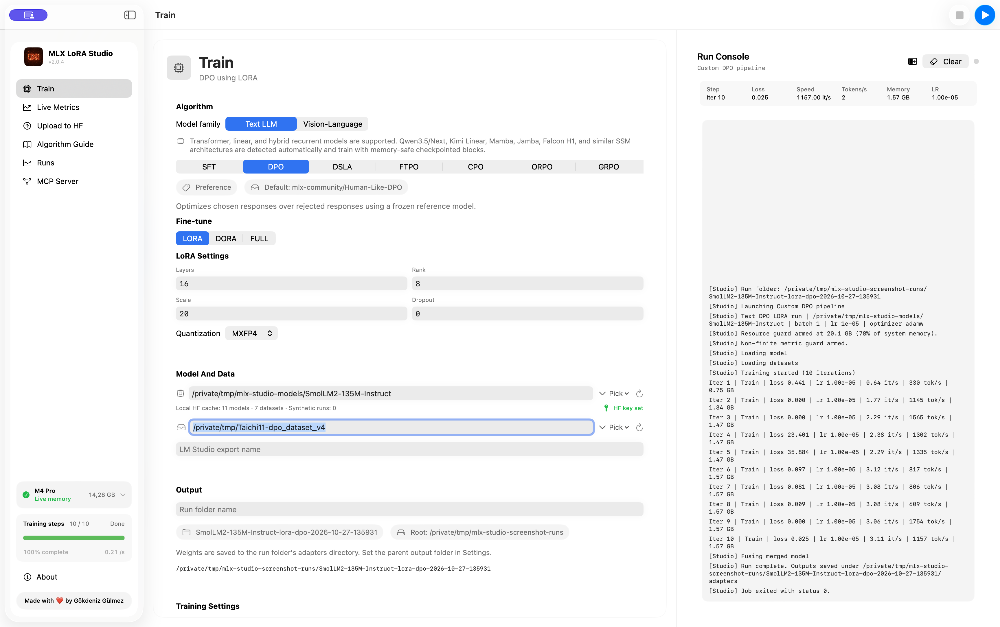
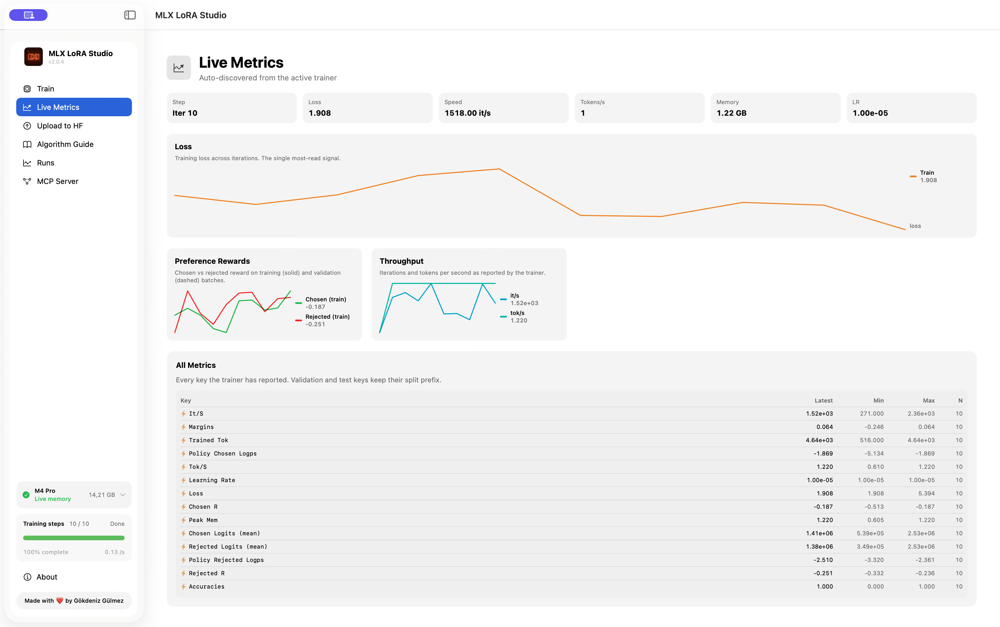
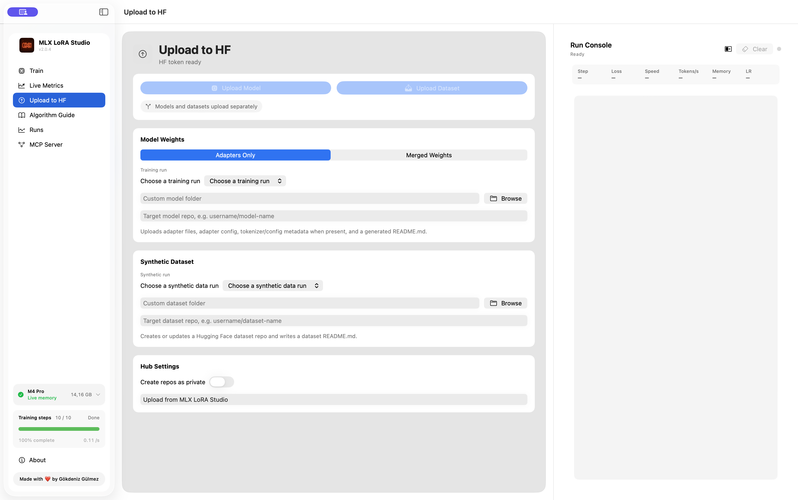
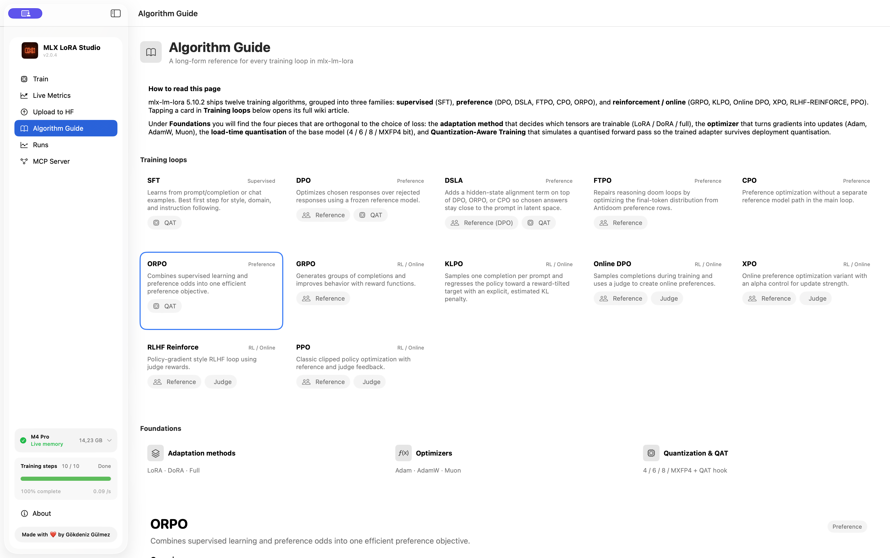
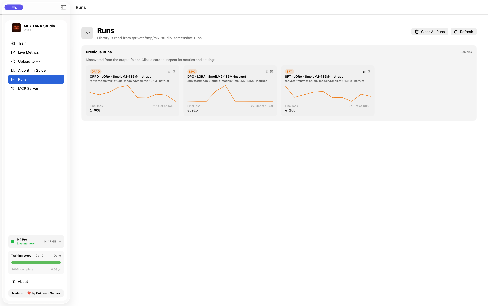
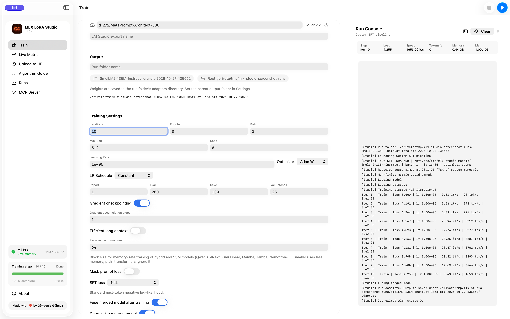
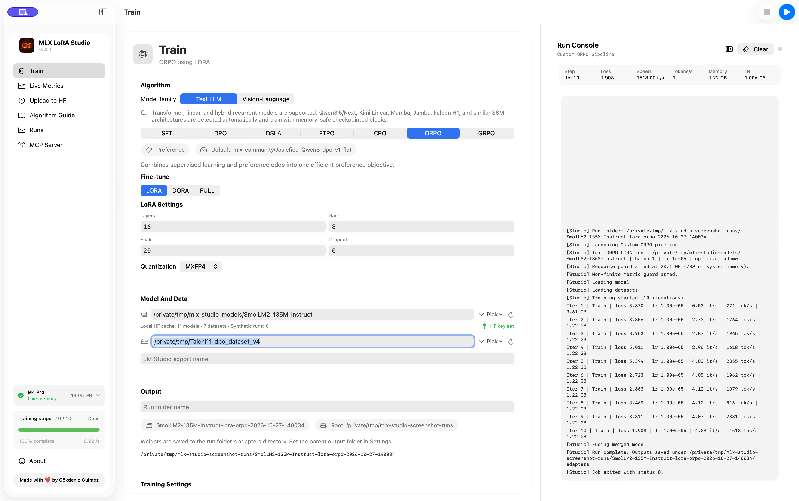

<p align="center">
  
</p>

<p align="center">
  <strong>A native Mac App for LLM fine-tuning on Apple Silicon — fully on-device, fully open source.</strong>
</p>

<p align="center">
  Train locally, inspect each run, and keep control of your model and data.
</p>

---

## Table of contents

- [Training stack](#training-stack)
- [Why MLX LoRA Studio?](#why-mlx-lora-studio)
- [What it is](#what-it-is)
- [What it isn't](#what-it-isnt)
- [Features at a glance](#features-at-a-glance)
- [Screenshots](#screenshots)
- [Installation](#installation)
- [Quick start](#quick-start)
- [A guided tour of the app](#a-guided-tour-of-the-app)
  - [Train](#train)
  - [Live Metrics](#live-metrics)
  - [Upload to HF](#upload-to-hf)
  - [Algorithm Guide](#algorithm-guide)
  - [Runs](#runs)
  - [Settings](#settings)
- [The training pipeline under the hood](#the-training-pipeline-under-the-hood)
- [Supported training methods](#supported-training-methods)
- [Configuration reference](#configuration-reference)
- [Memory & hardware expectations](#memory--hardware-expectations)
- [Building from source](#building-from-source)
- [Project layout](#project-layout)
- [Contributing](#contributing)
- [Star History](#star-history)
- [License](#license)
- [Acknowledgments](#acknowledgments)

---

## Training stack

The repository currently vendors [`mlx-lm-lora` 5.10.2](vendor/mlx-lm-lora/), the Python
training package behind the app. Studio runs its trainer locally on Apple Silicon and
surfaces its settings, progress, logs, and saved adapters in a native macOS interface.
Version 5.10.2 adds epoch-based training budgets and a read-only `calculate_iters` MCP tool,
fixes completed-run detection after restarts, and makes Hugging Face dataset loading tolerate
incomplete optional PyTorch namespaces.

- **DSLA** (Directional and Similarity-aware Latent Alignment) extends DPO, ORPO, or CPO.
- **KLPO** (KL-Regularized Policy Optimization) adds a critic-free RL loop using GRPO reward functions.
- **FTPO** (Fine-grained Token Preference Optimization) learns from token-level preference data.
- A recurrence chunk size and fast VJPs support hybrid and SSM models such as Qwen3.5/Next,
  Kimi Linear, Mamba, and Jamba.
- Online preference and RL methods use an explicit judge model. The backend requires Python 3.11+.

### What's included

- **Native macOS app for Apple Silicon** built with SwiftUI and AppKit.
- **Fully local fine-tuning workflow** for MLX-compatible language models.
- **12 training algorithms:** SFT, DPO, DSLA, FTPO, CPO, ORPO, GRPO, KLPO, Online DPO, XPO,
  RLHF Reinforce, and PPO.
- **Dynamic SFT objectives:** NLL, memory-bounded Chunked NLL, and Dynamic Fine-Tuning.
- **Multiple training modes:** LoRA, DoRA, QLoRA at 4/6/8-bit, full fine-tuning, and
  Quantization-Aware Training (QAT).
- **Live training observability** with loss, learning rate, gradient norm, throughput,
  progress, logs, and recent-step charts.
- **Memory-aware run planning** with live wired/active memory monitoring and ResourceGuard
  checks before launch.
- **Runs archive** for configs, logs, adapters, run status, resume flows, Finder reveal,
  and upload handoff.
- **Hugging Face upload flow** with repository settings, model-card metadata, token handling,
  license selection, and progress feedback.
- **Algorithm Guide** explaining when to use each method, which hyperparameters matter, and
  common failure modes.
- **Python environment discovery and provisioning** so users can start from the app instead
  of hand-assembling dependencies.
- **Self-contained app bundle** that includes the Swift app, Python helpers, and bundled
  trainer resources.
- **MIT-licensed source code** so the community can inspect, modify, improve, and build on
  the project.

---

## Why MLX LoRA Studio?

Studio puts model selection, training controls, resource estimates, run logs, and adapter
outputs in one native Mac app. Training executes locally on Apple Silicon. Model and dataset
downloads use the network, and publishing an adapter to Hugging Face is an explicit step.

- The app provisions or finds the Python environment and the `mlx-lm-lora` trainer.
- Twelve supervised, preference, and reinforcement algorithms are available alongside LoRA,
  DoRA, QLoRA, full fine-tuning, and Quantization-Aware Training.
- YAML configurations, live metrics, logs, and saved adapters remain inspectable.
- The companion [`mlx-lm-lora` Python package](https://github.com/Goekdeniz-Guelmez/mlx-lm-lora)
  can also be used directly from the command line or from the
  [open notebook examples](https://github.com/Goekdeniz-Guelmez/mlx-lm-lora-example-notebooks).

---

## What it is

- A **native macOS app** written in **SwiftUI + AppKit**, distributed as a single `.app` and
  an installable `.dmg`.
- A **graphical front-end** to the [`mlx-lm-lora`](https://github.com/Goekdeniz-Guelmez/mlx-lm-lora)
  Python training pipeline (also developed by the author of this app), with a few
  Swift-side services around it: environment discovery, live memory monitoring, the
  ResourceGuard that keeps the GPU from being driven into swap, run archival, and HF upload.
- A **complete workflow** — train, watch live metrics, push the
  resulting adapter to the Hub — without leaving the window.

## What it isn't

- Not a general LLM chat app, IDE, or inference server. (Bring your own for inference;
  Studio produces the adapter you can serve from `mlx-lm` or `ollama`.)
- Not a cross-platform app. **macOS 14+ on Apple Silicon only** — it depends on the
  [MLX](https://github.com/ml-explore/mlx) framework, which is Apple Silicon–only.
- Not a fork of someone else's training code. The trainer is the author's own work, and the
  Studio is a graphical surface for it.

---

## Features at a glance

### Training

- **12 training algorithms** out of the box: SFT, DPO, DSLA, FTPO, CPO, ORPO, GRPO, KLPO,
  Online DPO, XPO, RLHF Reinforce, PPO. Pick by use case, not by which one is wired up.
- **Selectable SFT losses:** NLL, Chunked NLL for lower peak memory, and DFT for emphasizing difficult tokens.
- **LoRA, DoRA, QLoRA (4/6/8-bit), full fine-tuning, and QAT** (Quantization-Aware Training
  for SFT/DPO/ORPO/DSLA) — the same training surface as the underlying `mlx-lm-lora` CLI.
- **Adapter resume** — point a new run at an existing adapter checkpoint and Studio picks
  up where the last run left off.
- **Judge / reward model selection** for RL-style algorithms (GRPO, XPO, Online DPO, PPO,
  RLHF Reinforce): pick a base model + a judge model from the Hugging Face cache.
- **YAML-driven configuration** — the GUI's form is a *view* over a YAML config; the
  same config can be exported and rerun on the CLI.

### Live observability

- **Live metrics panel** with loss, learning rate, gradient norm, throughput, and a
  refreshable plot of recent steps.
- **Live memory monitor** in the sidebar: current wired + active memory, plus a static
  estimate of what the *current configuration* should cost.
- **Run progress bar** in the sidebar while a job is in flight.
- **Pause / resume / stop** from the toolbar without losing the run.

### Publish

- **One-click Hugging Face upload** of adapters (LoRA / DoRA / QLoRA / QAT) with
  metadata, model card, and license pickers.
- **Runs archive** — each run keeps its configuration, logs, and adapter output in the
  configured run folder, surfaced in *Runs* for inspection, resume, or upload.

### Engineering

- **Python environment discovery & provisioning** — Studio finds an existing venv/conda
  env that has the trainer installed, or provisions one for you. No "I forgot to install
  the deps" loop.
- **ResourceGuard** — watches the OS memory pressure signals and refuses to start a
  job the system can't fit, with a clear human-readable reason.
- **Self-contained app bundle** — the bundled Python + `mlx-lm-lora` checkout is
  copied into the app, so a drag-installed copy works without the source tree.

---

## Installation

### Option 1 — Download a release (recommended for users)

1. Go to the [Releases](../../releases) page.
2. Download the latest `MLX-LoRA-Studio-X.Y.Z.dmg`.
3. Open the DMG, drag **MLX LoRA Studio** to **/Applications**.
4. Eject the DMG, then launch the app from `/Applications` or Spotlight.

The first time you start a run, Studio will **discover or provision** a Python environment
with the right dependencies — no terminal needed.

### Option 2 — Build it yourself

See [Building from source](#building-from-source) below.

### System requirements

| Component | Requirement                                                          |
|-----------|----------------------------------------------------------------------|
| OS        | **macOS 14 (Sonoma) or later**                                       |
| Chip      | **Apple Silicon** (M1 / M2 / M3 / M4 family). Intel is not supported. |
| RAM       | **16 GB minimum**; 24 GB+ recommended for ≥13B models               |
| Disk      | ~5 GB for the app + a per-model HF cache (varies by model)           |
| Python    | Bundled Python is used; a system Python is **not** required          |

---

## Quick start

1. **Launch MLX LoRA Studio.**
2. On the **Train** tab:
   - Pick an **MLX-compatible base model** from your local Hugging Face cache, such as
     `mlx-community/SmolLM2-135M-Instruct-4bit`.
     The worked examples below use the upstream
     [`HuggingFaceTB/SmolLM2-135M-Instruct`](https://huggingface.co/HuggingFaceTB/SmolLM2-135M-Instruct)
     checkpoint converted to MLX format.
   - Pick a **dataset** from your local cache, such as `d1272/MetaPrompt-Architect-500`.
   - Leave the algorithm at **SFT** for a first run.
   - Hit **Run** in the toolbar.
3. The **sidebar memory card** updates in real time; the **Live Metrics** tab shows
   loss / learning rate as the run progresses. Pause, resume, or stop from the toolbar.
4. When the run finishes, open **Runs** → select the run → **Upload to HF**
   to publish the adapter.

> **Tip:** the **Algorithm Guide** tab in the sidebar explains *why* you'd pick DPO
> over SFT, when GRPO makes sense, and how QAT differs from QLoRA — it pairs with the
> **Train** tab rather than replacing it.

---

## A guided tour of the app

The sidebar has six main views: Train, Live Metrics, Upload to HF, Algorithm Guide, Runs,
and MCP Server. About and Settings are available from the app interface.

### Train

<p align="center">
  
</p>

The training form is grouped into:

1. **Algorithm and model family** — select one of the supported training methods and
   text or vision-language input.
2. **Fine-tuning method** — choose LoRA, DoRA, or full fine-tuning, with quantization
   and adapter settings where they apply.
3. **Model and data** — select the model and dataset, plus dataset-column mappings when
   the source schema needs them.
4. **Training settings** — set iterations or epochs, batch size, sequence length,
   learning rate, optimizer, reporting, evaluation, and gradient options.
5. **Algorithm-specific settings** — preference loss and beta, judge/reward options,
   or SFT loss settings are shown for the selected method.
6. **Output** — choose where the run and adapter are saved.

A **memory estimate** at the bottom of the form shows what the current configuration
*should* cost, so you can change a knob and immediately see the projected effect.

### Live Metrics

<p align="center">
  
</p>

A live view of the selected run:

- Loss / reward / KL over the last N steps, with a refreshable line plot.
- Throughput (tokens/sec) and elapsed time.
- Recent step metrics, a loss chart, and run progress.
- The Train view also keeps the streaming run console beside the configuration.

### Upload to HF

<p align="center">
  
</p>

A guided form for pushing a finished adapter to the Hugging Face Hub:

- Repository name, visibility (public / private), license.
- Model card fields: base model, language, tags, dataset card, intended use.
- Token source: env var, keychain entry, or paste.
- One **Push** button. The app shows a step-by-step progress feed and a final URL.

### Algorithm Guide

<p align="center">
  
</p>

A built-in reference for the supported algorithms. Each entry covers:

- **What it is** in one paragraph, with the math in plain words.
- **When to use it** — the practical "SFT first, then DPO" ladder.
- **Key hyperparameters** and how to think about them.
- **Failure modes** — what goes wrong if beta is too high, group size is too small, etc.

This is the screen to open when a user is choosing between, say, ORPO and CPO, and
isn't sure which one applies to their data.

### Runs

<p align="center">
  
</p>

A table of every run Studio has ever done, sorted by recency:

- Status (running / paused / done / failed / cancelled).
- Algorithm, base model, dataset, last loss, duration.
- The run's full YAML config and final adapter path.
- Actions: **Open** (loads it back into the form), **Resume** (start a new run from
  the same adapter), **Upload to HF**, **Reveal in Finder**, **Delete**.

### Settings

- **Settings** controls the Python environment, output location, and Hugging Face
  credentials. Credentials are stored in Keychain; the app reports their status without
  displaying the token.

---

## Small, real training runs

These full-screen captures come from short runs in the app, all using the same
[`HuggingFaceTB/SmolLM2-135M-Instruct`](https://huggingface.co/HuggingFaceTB/SmolLM2-135M-Instruct)
base model. The Hub model was converted to MLX format
before training and quantized with MXFP4 so its layer dimensions fit the selected group size.
Each run used 10 training steps to demonstrate the workflow and live reporting. These runs
are not model-quality benchmarks.

| Run | Dataset | What the method does |
|-----|---------|----------------------|
| SFT | [d1272/MetaPrompt-Architect-500](https://huggingface.co/datasets/d1272/MetaPrompt-Architect-500), 500 chat rows, MIT | Learns from example conversations. |
| DPO | [Taichi11/dpo_dataset_v4](https://huggingface.co/datasets/Taichi11/dpo_dataset_v4), 2,878 preference pairs, Apache-2.0; demo uses 100 rows | Prefers the chosen response over the rejected response. |
| ORPO | Same 100-row preference subset | Combines supervised learning and preference odds in one objective. |

<p align="center">
  
</p>

<p align="center">
  
</p>

<p align="center">
  
</p>

---

## The training pipeline under the hood

```
┌─────────────────────────────────────────────────────────────────────┐
│  SwiftUI app  (Sources/MLXLoRAStudio)                               │
│  ┌──────────────┐   ┌─────────────────┐   ┌──────────────────────┐ │
│  │ AppStore     │──▶│ PythonJobRunner │──▶│ LiveMemoryMonitor    │ │
│  │ (state)      │   │ (subprocess +   │   │ + ResourceGuard      │ │
│  └──────────────┘   │  line streaming)│   └──────────────────────┘ │
│                     └────────┬────────┘                             │
│                              │ stdin/stdout                         │
└──────────────────────────────┼──────────────────────────────────────┘
                               │
                               ▼
┌─────────────────────────────────────────────────────────────────────┐
│  Python helper  (Backend/training_runner.py)                        │
│  • Translates the YAML config into mlx-lm-lora CLI flags            │
│  • Streams metrics on stdout as JSON lines                          │
│  • Saves adapter checkpoints under the run dir                      │
└──────────────────────────────┬──────────────────────────────────────┘
                               │
                               ▼
┌─────────────────────────────────────────────────────────────────────┐
│  mlx-lm-lora  (vendor/mlx-lm-lora — same code the CLI uses)         │
│  • SFT / DPO / CPO / ORPO / GRPO / Online DPO / XPO /               │
│    RLHF Reinforce / PPO                                             │
│  • LoRA / DoRA / QLoRA / full / QAT                                 │
│  • MLX-native training, fused-metal on Apple Silicon                │
└─────────────────────────────────────────────────────────────────────┘
```

The app and the trainer communicate over a simple line-delimited JSON protocol: the
runner emits one JSON object per training step (loss, lr, grad_norm, tokens/sec, etc.),
plus structured `event` lines for phase changes (`starting`, `epoch`, `checkpoint`,
`done`, `error`). This keeps the Swift side reactive without polling.

---

## Supported training methods

Mirrored from the underlying `mlx-lm-lora` trainer:

| Family   | Algorithms                                                                                  |
|----------|---------------------------------------------------------------------------------------------|
| Supervised fine-tuning | SFT |
| Preference optimization | DPO, DSLA, FTPO, CPO, ORPO |
| Reinforcement learning | GRPO, KLPO, Online DPO, XPO, RLHF Reinforce, PPO |

| Adapter type                  | Notes                                                          |
|-------------------------------|----------------------------------------------------------------|
| **LoRA**                      | Low-rank adapters, configurable rank / alpha / target modules  |
| **DoRA**                      | Weight-decomposed LoRA                                        |
| **QLoRA (4/6/8-bit)**          | Quantized base model + LoRA adapters                           |
| **Full fine-tuning**          | Train all parameters                                           |
| **QAT** (Quantization-Aware)  | SFT / DPO / ORPO; project quantization during training         |

All combinations are exposed in the **Train** tab's adapter section.

---

## Configuration reference

The GUI's form maps 1:1 to a YAML file (also the format the underlying `mlx-lm-lora` CLI
takes). You can find every run's config in `~/Library/Application Support/MLXLoRAStudio/runs/`.

A minimal SFT example:

```yaml
# Example configuration; available options depend on the selected algorithm.

train_mode: sft
model: mlx-community/SmolLM2-135M-Instruct-4bit
dataset:
  - d1272/MetaPrompt-Architect-500
adapter:
  type: lora
  rank: 16
  alpha: 32
  dropout: 0.05
  target_modules: [q_proj, k_proj, v_proj, o_proj]
optim:
  learning_rate: 2.0e-4
  schedule: cosine
  warmup_steps: 20
  weight_decay: 0.0
  grad_accumulation_steps: 8
train:
  max_steps: 1000
  batch_size: 2
  max_seq_len: 2048
  save_every: 200
output:
  adapter_path: ~/Library/Application Support/MLXLoRAStudio/runs/<id>/adapter
```

> Run a YAML directly from the terminal (no GUI):
>
> ```bash
> python -m mlx_lm_lora -c my_run.yaml
> ```

---

## Memory & hardware expectations

Approximate, single-GPU Apple Silicon, batch_size 2, 2048-token sequences:

| Base model size | LoRA r=16 | QLoRA 4-bit | Full FT |
|-----------------|-----------|-------------|---------|
| 1B–3B           | 8 GB      | 5 GB        | 12 GB   |
| 7B–8B           | 14 GB     | 7 GB        | 32 GB   |
| 13B             | 22 GB     | 10 GB       | 56 GB   |
| 70B             | 110 GB    | 38 GB       | —       |

The **live memory card** in the sidebar shows the OS's reported wired + active memory;
the **memory estimate** below the form shows what the current configuration should
cost, given the base model size, the sequence length, the adapter shape, and the
quantization mode. **ResourceGuard** refuses to start a run whose estimated cost
would push the system into swap.

The Python runner keeps a bounded cache of tokenized training and validation
examples (512 examples per split by default) and does not cache the one-pass test
split. Set `MLX_LORA_STUDIO_DATASET_CACHE_ITEMS=0` before launching the app to
disable processed-example caching, or set another non-negative value to change
the per-split limit.

---

## Building from source

Requires the Xcode command-line tools (Swift 5.9+, macOS 14+ SDK):

```bash
git clone https://github.com/Goekdeniz-Guelmez/MLX-LoRA-Studio.git
cd MLX-LoRA-Studio

# Build + run the app:
./script/build_and_run.sh

# Build a release .dmg:
./script/build_and_run.sh --package

# Build locally and upload the assets to a GitHub Release:
gh auth login
./script/build_and_run.sh --release-package

# Open the .app in lldb:
./script/build_and_run.sh --debug

# Tail the unified log while the app runs:
./script/build_and_run.sh --logs
```

To sign a local package with Developer ID and notarize the DMG, copy
`apple/signing.local.env.example` to `apple/signing.local.env`, set your Developer
ID identity and team ID, create the suggested `notarytool` keychain profile, and
set `NOTARY_PROFILE` to that profile name.
The build script loads that ignored local file automatically. When a notary
profile is configured, `--package`, `--release-assets`, and `--release-package`
submit and staple the resulting DMG. You can instead provide `NOTARY_APPLE_ID`,
`NOTARY_TEAM_ID`, and `NOTARY_PASSWORD`; the keychain profile is preferred so
the app-specific password does not need to be stored in a file.
`--release-package` uses the version in the `version` file, then creates or
updates the matching GitHub release and uploads the DMG, checksum, and app ZIP.

The build script:

1. Compiles all Swift files in `Sources/MLXLoRAStudio/` with `swiftc` against
   `SwiftUI` and `AppKit`.
2. Fetches the pinned `mlx-lm-lora` 5.10.2 checkout when it is absent, then
   bundles it with the app icon and Python helper (`Backend/`) into
   `Contents/Resources/`. The checkout and Python environment remain local and
   are not committed to source control.
3. Stamps the version from the `version` file at the repo root into
   `Info.plist`.

The output `.app` is fully self-contained — you can copy it to another Mac and
it will still run, as long as that Mac has Python access (or you let Studio
provision one).

---

## Project layout

```
.
├── Sources/
│   ├── Media/                       # logo.png, logo_ultra-wide.png
│   └── MLXLoRAStudio/
│       ├── App/                     # App entry point (SwiftUI @main)
│       ├── Models/                  # TrainingModels, PythonEnvironment
│       ├── Services/                # PythonJobRunner, HFCacheScanner, …
│       ├── Stores/                  # AppStore (Observable state root)
│       ├── Support/                 # LiveMemoryMonitor, MemoryEstimator
│       └── Views/                   # All SwiftUI screens
├── Backend/                         # Python helpers invoked by the Swift side
│   ├── training_runner.py
│   └── hf_upload.py
├── vendor/
│   └── mlx-lm-lora/                 # The training library the GUI wraps
├── script/
│   └── build_and_run.sh             # Builds .app + .dmg
├── Tests/
├── .github/workflows/tests.yml      # Backend test workflow
├── Package.swift                    # SwiftPM manifest
├── version                          # Single source of truth for the app version
└── README.md
```

---

## Contributing

Bug reports, feature requests, and PRs are very welcome.

- **Bugs / UX issues** → open an issue with the macOS version, chip, and a small log
  excerpt from `Console.app` filtered on the `MLXLoRAStudio` subsystem.
- **Algorithm / trainer changes** → open the issue in
  [`mlx-lm-lora`](https://github.com/Goekdeniz-Guelmez/mlx-lm-lora) first; the trainer
  is the source of truth, and the GUI follows it.
- **GUI-only changes** → fork, branch, run `./script/build_and_run.sh --verify` to
  smoke-test the bundle, and open a PR.

For larger changes, please open an issue first to align on direction.

---

## Star History

<a href="https://star-history.com/#Goekdeniz-Guelmez/MLX-LoRA-Studio&Date">
  <picture>
    <source media="(prefers-color-scheme: dark)" srcset="https://api.star-history.com/svg?repos=Goekdeniz-Guelmez/MLX-LoRA-Studio&type=Date&theme=dark" />
    <source media="(prefers-color-scheme: light)" srcset="https://api.star-history.com/svg?repos=Goekdeniz-Guelmez/MLX-LoRA-Studio&type=Date" />
    
  </picture>
</a>

---

## License

MIT — see `LICENSE` for the full text. The vendored
[`mlx-lm-lora`](vendor/mlx-lm-lora/) and the Python helpers in `Backend/` are MIT
under the same project.

---

## Acknowledgments

- [Apple MLX](https://github.com/ml-explore/mlx) — the array framework that makes
  on-device training actually pleasant on Apple Silicon.
- [mlx-lm](https://github.com/ml-explore/mlx-lm) — the model + tokenizer plumbing
  that `mlx-lm-lora` builds on.
- [Hugging Face](https://huggingface.co) — model + dataset hub; the entire
  community-trained ecosystem this app is a window into.
